| | |
|---|---|
| **Name** | Kinley Palden |
| **Student ID** | 02230287 |
| **Module** | SWS405 – Unit VII |
| **Lab** | Static and Dynamic Malware Analysis (harmless ransomware-behaviour simulator) |
| **Date** | 19 November 2026 |

# 1. Objective

Analyse a suspicious training sample (`suspicious_sample.py`) without running it, using file identification, hashing, strings, hex inspection and YARA. Then run it under controlled monitoring with strace, file-system comparison and network-state checks. Compare the static predictions with the observed behaviour and record the findings as training IOCs.

# 2. Environment

| Item | Value |
|---|---|
| OS | Kali Linux, kernel 7.1.5+kali-amd64 |
| Lab directory | `~/Desktop/Lab06_SWS405/SWS405_MalwareLab` |
| Tools | file 5.47, GNU strings 2.40, xxd, YARA 4.5.8, strace 7.2, ss, python3 |
| Network | Not isolated (Wi-Fi connected). See Limitations. |

# 3. Methodology

1. Copy the sample and the YARA rule into a dedicated lab directory.
2. **Static analysis (Part A):** run `file`, `md5sum`/`sha1sum`/`sha256sum`, `strings`, `xxd` and `yara` without executing the sample.
3. **Dynamic analysis (Part B):** record a file-system baseline, run the sample under `strace`, then compare the created files, check the network state and re-verify the sample hash.
4. Compare the static predictions with the dynamic evidence and record IOCs.

---

# PART A – Static Analysis

## A1. File identification

```
$ file suspicious_sample.py national.exe.pdf
suspicious_sample.py: Python script, Unicode text, UTF-8 text executable
national.exe.pdf:     Python script, ASCII text executable
```

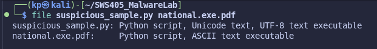{width=100%}

**Interpretation:** the sample is a text-based Python script, not a Windows PE executable. `national.exe.pdf` shows the same point: its double extension suggests a PDF or EXE, but its content is a Python script. A filename extension proves nothing; `file` identifies the type from the content.

## A2. Hashing and fingerprinting

```
MD5    : 29feb123f1f062328b746b1fdb332612
SHA-1  : b91aa1f51901d2fa48ef83b84c8ef34389ccc10e
SHA-256: 7ef94bfb15c7479e209a701b40cf6994a2f9c4b0870b4576966b43050554bc26
```

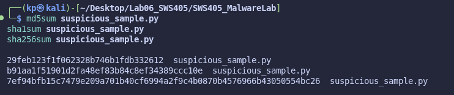{width=100%}

```
$ sha256sum suspicious_sample.py > sample_hash_before.txt
$ sha256sum -c sample_hash_before.txt
suspicious_sample.py: OK
```

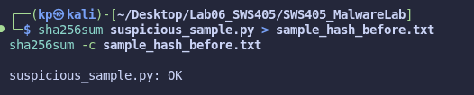{width=100%}

## A3. Strings analysis

```
$ strings -a suspicious_sample.py | grep -Ei 'SIMULATED|LOCKED|encrypt|NOTE_CREATE|FILE_READ|LOG_WRITE|lab_workspace'
```

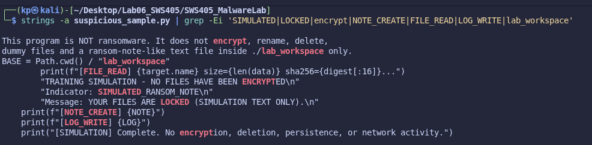{width=100%}

| String | Significance |
|---|---|
| `SIMULATED_RANSOM_NOTE` | Indicator that a ransom note is produced |
| `YOUR FILES ARE LOCKED` | Typical ransom-note wording |
| `NO FILES HAVE BEEN ENCRYPTED` / `encrypt` | Encryption-related wording |
| `FILE_READ` | The program reads files |
| `NOTE_CREATE` | The program writes a note file |
| `LOG_WRITE` | The program writes a log |
| `lab_workspace` | The target directory for the file activity |

**Interpretation:** these strings suggest the program creates and reads files and drops a ransom-note-like message. Strings alone don't prove the behaviour; dynamic analysis has to confirm it.

## A4. Hexadecimal inspection

```
$ xxd -l 128 suspicious_sample.py
00000000: 2321 2f75 7372 2f62 696e 2f65 6e76 2070  #!/usr/bin/env p
```

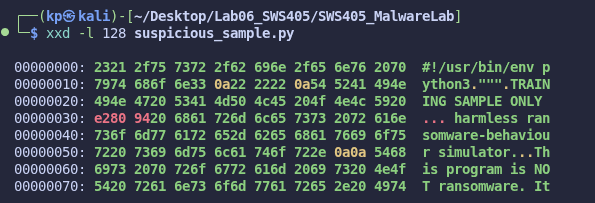{width=100%}

**Interpretation:** the file starts with `23 21` (`#!`), a script shebang. A Windows PE file would start with `4D 5A` (`MZ`), so this confirms the file is a text script.

## A5. YARA pattern matching

```
$ yara -s sws405_ransom_simulator.yar suspicious_sample.py
SWS405_Harmless_Ransomware_Simulator suspicious_sample.py
0x82f:$marker1: SIMULATED_RANSOM_NOTE
0x85a:$marker2: YOUR FILES ARE LOCKED
0xa88:$marker3: No encryption, deletion, persistence
```

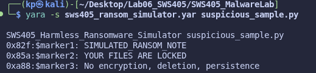{width=100%}

**Interpretation:** all 3 markers matched; the rule needs 2. This classifies the file as the known training sample, but a YARA match alone doesn't prove a file is malicious.

## A6. Static analysis worksheet

| Question | Observation | What it means |
|---|---|---|
| What is the real file type? | Python script, UTF-8 text | An interpreted script, not a PE binary |
| What is the SHA-256 hash? | `7ef94bfb…50554bc26` | Unique fingerprint for this content, used as an IOC and for the integrity check |
| Which suspicious strings were found? | `SIMULATED_RANSOM_NOTE`, `YOUR FILES ARE LOCKED`, `FILE_READ`, `NOTE_CREATE`, `LOG_WRITE`, `lab_workspace` | Ransom-note text and file-operation markers |
| What file operations are suggested? | Create a directory, create and read files, write a note, append to a log | A ransomware-like staging pattern |
| Does YARA match? Which strings? | Yes: `$marker1`, `$marker2`, `$marker3` | Matches the known training-sample pattern |
| What should be monitored dynamically? | File-system changes, `mkdir`/`openat` calls, process creation, network calls | These test the static hypotheses |

---

# PART B – Dynamic Analysis

## B1. Baseline

```
$ ls -la lab_workspace
ls: cannot access 'lab_workspace': No such file or directory
$ find . -maxdepth 2 -type f -printf '%p | %s bytes\n' | sort
```

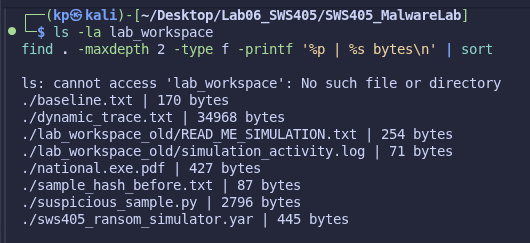{width=100%}

**Interpretation:** `lab_workspace` doesn't exist before execution. The `lab_workspace_old/` folder in the listing holds output from an earlier test run. It was renamed so this run would start from a clean baseline.

## B2 and B3. Process observation and system-call tracing

```
$ strace -f -o dynamic_trace.txt -e trace=%file,%process,%network python3 suspicious_sample.py
```

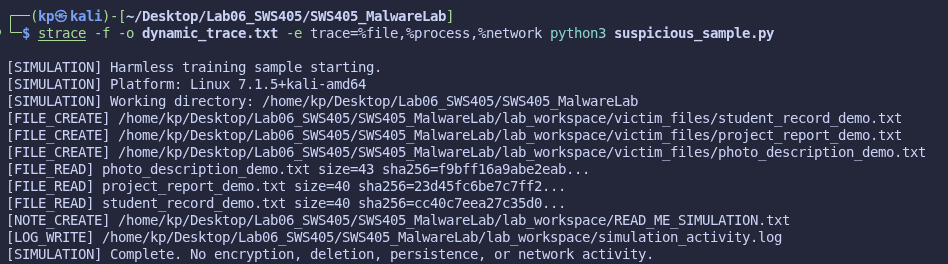{width=100%}

**Program output:** the sample created 3 dummy files (`FILE_CREATE`), read them back (`FILE_READ`), created `READ_ME_SIMULATION.txt` (`NOTE_CREATE`), wrote `simulation_activity.log` (`LOG_WRITE`) and finished.

**Process:** the trace shows a single `python3 suspicious_sample.py` process (PID 659698), started by `execve()`, with no child processes. The process is very short-lived, so it finishes almost instantly and a 1-second `ps`/`watch` refresh may not catch it.

```
$ grep -E 'mkdir|openat|execve' dynamic_trace.txt | grep -E 'lab_workspace|execve'
```

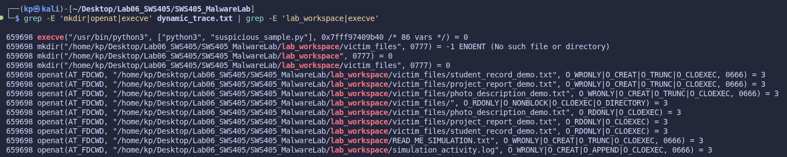{width=100%}

| System call | Meaning |
|---|---|
| `execve("/usr/bin/python3", ["python3","suspicious_sample.py"])` | Process execution |
| `mkdir(".../lab_workspace")`, `mkdir(".../victim_files")` | Directory creation |
| `openat(..."student_record_demo.txt", O_WRONLY\|O_CREAT\|O_TRUNC)` (×3) | Dummy file creation |
| `openat(..."victim_files/", O_RDONLY\|O_DIRECTORY)` | Directory enumeration |
| `openat(..."*.txt", O_RDONLY)` (×3) | File reads |
| `openat(..."READ_ME_SIMULATION.txt", O_WRONLY\|O_CREAT\|O_TRUNC)` | Ransom-note drop |
| `openat(..."simulation_activity.log", O_WRONLY\|O_CREAT\|O_APPEND)` | Log append |

```
$ grep -E 'AF_INET|connect\(' dynamic_trace.txt; echo "exit=$?"
exit=1
```

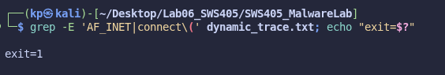{width=100%}

**Interpretation:** `exit=1` means grep found no matches, so the trace recorded no `AF_INET` socket or `connect()` calls.

## B4. Created files compared with the baseline

```
$ find lab_workspace -type f -printf '%p | %s bytes\n' | sort
lab_workspace/READ_ME_SIMULATION.txt | 254 bytes
lab_workspace/simulation_activity.log | 71 bytes
lab_workspace/victim_files/photo_description_demo.txt | 43 bytes
lab_workspace/victim_files/project_report_demo.txt | 40 bytes
lab_workspace/victim_files/student_record_demo.txt | 40 bytes
$ cat lab_workspace/READ_ME_SIMULATION.txt
TRAINING SIMULATION - NO FILES HAVE BEEN ENCRYPTED
This is a harmless ransomware-behaviour exercise for SWS405.
Indicator: SIMULATED_RANSOM_NOTE
Message: YOUR FILES ARE LOCKED (SIMULATION TEXT ONLY).
Do not make any payment. This is not a real incident.
```

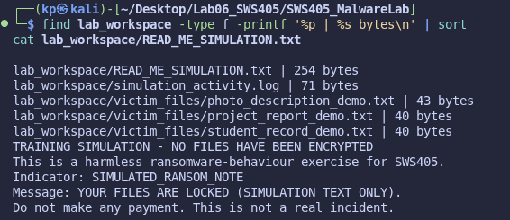{width=100%}

Activity log entry: `2026-11-19 03:40:53 SIMULATION_COMPLETE sha256_marker=e60c4ba0c5a5e008`

```
$ sha256sum lab_workspace/victim_files/* lab_workspace/READ_ME_SIMULATION.txt
f9bff16a9abe2eab16e94cfcd2fcc7dc7dd36b94277684e09e7f7f7dbcd1739f  photo_description_demo.txt
23d45fc6be7c7ff289cccbcd995d4562bd1fc37e69908d780b6e7133e8e56ca1  project_report_demo.txt
cc40c7eea27c35d0e1c94f988b189e4b13aab70abb310cefc6319ccd25f3861d  student_record_demo.txt
e60c4ba0c5a5e008c3a2aef7986bdba214b08cb17917a84f2b3e0a25254edd8e  READ_ME_SIMULATION.txt
```

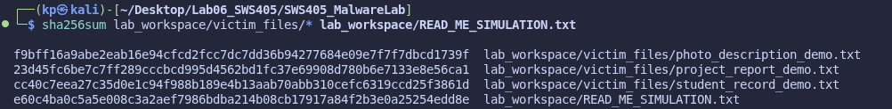{width=100%}

**Changes from the baseline:** a new `lab_workspace/` directory with `victim_files/` (3 dummy files of 40–43 bytes), `READ_ME_SIMULATION.txt` (254 bytes) and `simulation_activity.log` (71 bytes). No existing file outside `lab_workspace` was changed.

## B5. Network state

```
$ ss -tunap
```

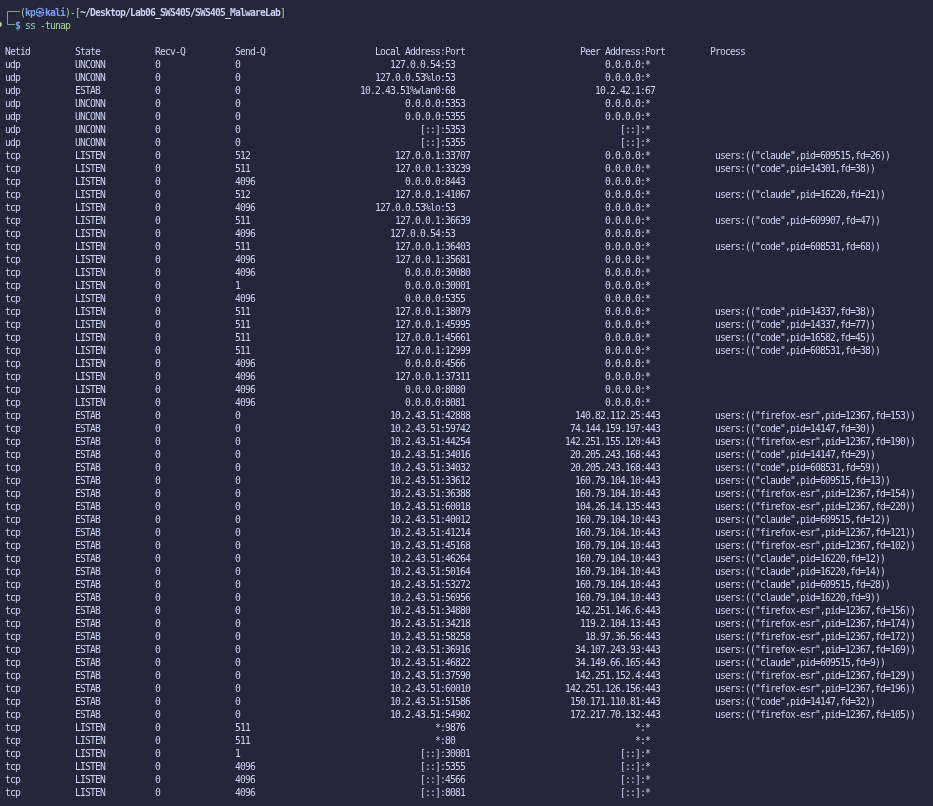{width=100%}

**Interpretation:** the sockets listed belong to existing system services (DNS, mDNS/LLMNR, DHCP) and to running applications such as Firefox and VS Code. None belongs to a `python3` process. Together with the empty network grep on the strace trace, this shows the sample made no network connection.

## B6. Sample integrity

```
$ sha256sum -c sample_hash_before.txt
suspicious_sample.py: OK
```

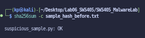{width=100%}

---

# 4. Static versus Dynamic Findings

| Static observation / prediction | Dynamic evidence | Conclusion |
|---|---|---|
| Strings include `FILE_CREATE` and `lab_workspace` | `mkdir` and `openat(O_CREAT)` calls under `lab_workspace` | Prediction confirmed |
| Strings include `YOUR FILES ARE LOCKED` | `READ_ME_SIMULATION.txt` contains this text, labelled as a simulation | Ransom-note wording is simulated |
| Code contains file-reading logic | `openat(O_RDONLY)` on the directory and on each dummy file | File access observed |
| No network indicators expected | No `AF_INET`/`connect` calls; no sample socket in `ss` | No network activity observed in this run |
| No encryption routine | Dummy files still contain plaintext `DEMO DATA ONLY` and keep their original sizes | No encryption observed |

# 5. Indicators of Compromise (training indicators)

| Type | Value |
|---|---|
| Sample filename | `suspicious_sample.py` |
| File type | Python text script (UTF-8) |
| SHA-256 | `7ef94bfb15c7479e209a701b40cf6994a2f9c4b0870b4576966b43050554bc26` |
| MD5 | `29feb123f1f062328b746b1fdb332612` |
| YARA match | `SWS405_Harmless_Ransomware_Simulator` (3/3 markers) |
| Created directory | `./lab_workspace/victim_files/` |
| Created note | `./lab_workspace/READ_ME_SIMULATION.txt` (SHA-256 `e60c4ba0…25254edd8e`) |
| Created log | `./lab_workspace/simulation_activity.log` |
| Process | `python3 suspicious_sample.py`, single process, no children |
| Network activity | None observed during this run |

*These are training indicators from a harmless simulator, not evidence of a real ransomware infection.*

---

# 6. Answers to Practical Questions

**Q1. Why should an examiner use `file` rather than trust a filename extension?**
An extension is just part of the name and can be set to anything. `file` checks the actual content (magic bytes, headers, encoding). For example, `national.exe.pdf` looks like a PDF or EXE but is really a Python script. Attackers use double extensions like this to trick users into opening malicious files.

**Q2. What is the difference between a filename and a cryptographic hash?**
Anyone can change a filename without changing the file's content. A cryptographic hash such as SHA-256 is calculated from the file's bytes, so it identifies the exact content regardless of the name. Changing a single byte produces a completely different hash. That makes hashes reliable for IOCs, threat-intelligence lookups and integrity checks.

**Q3. Which strings suggested suspicious behaviour before execution?**
`SIMULATED_RANSOM_NOTE`, `YOUR FILES ARE LOCKED`, `NO FILES HAVE BEEN ENCRYPTED`, `FILE_READ`, `NOTE_CREATE`, `LOG_WRITE` and `lab_workspace`/`victim_files`. Together they suggest a program that creates and reads files and drops a ransom note.

**Q4. Why does a YARA match not automatically prove that a file is malicious?**
YARA only matches patterns (strings, bytes and conditions). A harmless file, such as this report, security documentation or an antivirus signature file, can contain the same strings, which causes false positives. A rule also reflects only what its author chose to look for. A match is a lead for classification that still needs analysis and context.

**Q5. Which system calls in strace demonstrate file creation or file access?**
- `mkdir()` created `lab_workspace` and `victim_files`.
- `newfstatat()` checked whether each file existed.
- `openat()` with `O_WRONLY|O_CREAT|O_TRUNC` created the dummy files and the note.
- `openat()` with `O_CREAT|O_APPEND` wrote to the log.
- `openat()` with `O_RDONLY|O_DIRECTORY` enumerated the folder.
- `openat()` with `O_RDONLY` read each dummy file.
- `execve()` started the Python process.

**Q6. What changed between the baseline and post-execution file listings?**
Before execution, `lab_workspace` didn't exist. Afterwards there was a new `lab_workspace/` directory containing:
- `victim_files/` with 3 dummy `.txt` files (40–43 bytes each)
- `READ_ME_SIMULATION.txt` (254 bytes)
- `simulation_activity.log` (71 bytes)

No other files changed, and the sample's own hash stayed the same.

**Q7. Did the sample communicate over the network? What evidence supports your answer?**
No. strace traced the `%network` system-call class, and grepping the trace for `AF_INET` and `connect(` returned nothing (`exit=1`). `ss -tunap` showed no sockets owned by the sample's `python3` process. This applies to this run only; it doesn't guarantee how the sample behaves in other environments.

**Q8. Give one example of a static prediction confirmed by dynamic analysis.**
Statically, the `NOTE_CREATE` string and the ransom-note text predicted that the sample would write a ransom note. Dynamically, strace recorded `openat(".../lab_workspace/READ_ME_SIMULATION.txt", O_WRONLY|O_CREAT|O_TRUNC)`, and the file exists with the predicted text.

**Q9. Why should the VM be reverted after the practical?**
Running a sample can leave hidden changes, such as dropped files, persistence mechanisms, configuration changes or a compromised state. This is especially true with real malware. Reverting to a clean snapshot returns the system to a known-good state, prevents contamination of later exercises, and keeps future analysis reproducible.

---

# 7. Limitations

- The sample is a Python script, so PE-specific analysis (MZ header, sections, imports, packers) and Windows registry persistence couldn't be demonstrated.
- The lab was run on a Kali system with network access, not the isolated UTM VM the safety section recommends. This was acceptable only because the sample's source code was reviewed first and confirmed harmless.
- Dynamic analysis shows behaviour for this one run, environment and privilege level. Real malware may detect analysis tools, delay its actions, or need network or command-line triggers.
- The process was very short-lived, so periodic tools like `ps`/`watch` may miss it. The strace `execve` record is the main process evidence.
- `ss` gives a point-in-time snapshot. The optional tcpdump capture wasn't performed.

# 8. Conclusion

`suspicious_sample.py` is a Python script that imitates ransomware staging behaviour. It creates a working directory, writes "victim" files, enumerates and reads them, drops a ransom note and writes an activity log. Static analysis (file type, strings and YARA) correctly predicted this behaviour, and strace confirmed it with `mkdir` and `openat` system calls. No encryption, deletion, persistence or network activity was observed, and the sample's SHA-256 hash was unchanged after execution. The exercise shows how static analysis forms hypotheses and dynamic analysis confirms or rejects them.
